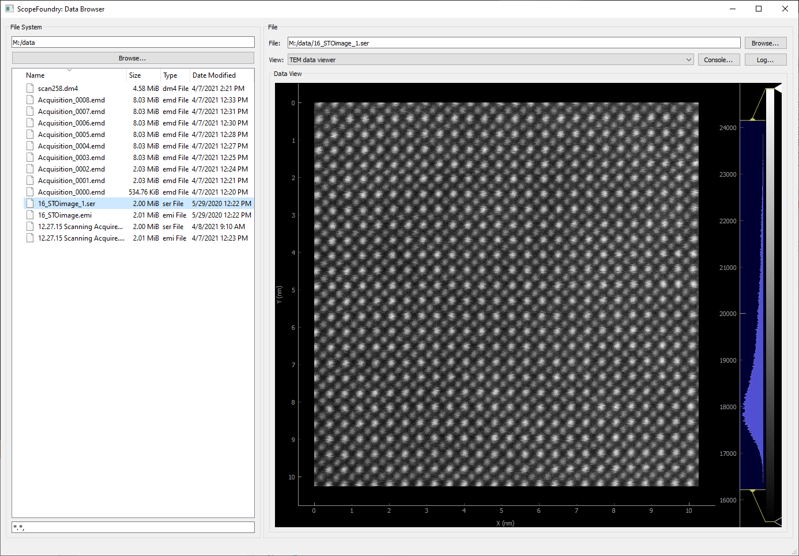

# TemDataBrowser
A graphical user interface based on ScopeFoundry for viewing TEM data.



# Installation
First install QT bindings. For example:

`$ pip install PyQt6`

Then install this package and the rest of the dependencies:

`$ pip install TemDataBrowser`

# Running the GUI

## From a python interpreter
Start python interpreter, import the package, and run the `open_file` function:

```
$ python
>>> import TemDataBrowser
>>> TemDataBrowser.main()
```

to start the graphical user interface.

## From the command line

A script should be installed on your system such that opening a command line
and typing `TemDataBrowser` will open the graphical user interface.

# MCP Server Integration

TemDataBrowser includes an optional embedded Model Context Protocol (MCP) server
implemented as a ScopeFoundry `DataBrowserPlugIn`, allowing external MCP clients
and AI assistants to load TEM/image files, push in-memory images/arrays, adjust
contrast, navigate 3D stacks, read metadata, and inspect rendered previews.

## Install with MCP support

```bash
pip install "TemDataBrowser[mcp]"
```

## Auto-start from the command line

Pass `--mcp` to auto-start the Streamable HTTP MCP server on launch:

```bash
TemDataBrowser --mcp
# or customize host and port:
TemDataBrowser --mcp --mcp-host 127.0.0.1 --mcp-port 8000
```

You can also open the **MCP** control panel inside the GUI (click the **MCP**
toolbar button or press `Ctrl+M`) to start, stop, or inspect the endpoint URL
(`http://127.0.0.1:8000/mcp` by default).
